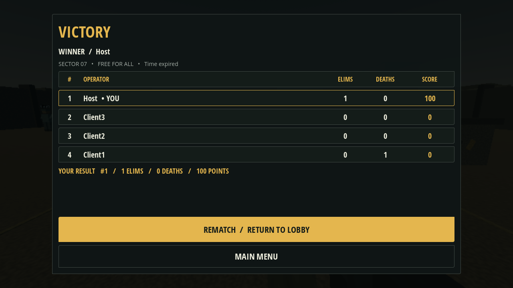

# SHADOWSTRIKE — Phase 5

An offline, Android-oriented 3D FPS training prototype built with **Godot 4.6.3 stable**, GDScript and the **Mobile renderer**. Training and combat are preserved, with **2–4 player host-authoritative offline LAN Free-for-All matches**, countdowns, live rankings, results and rematches. Host/join, predicted movement, authoritative shooting, health, eliminations, ammo, reloads and respawns are exercised with separate local Godot processes. Physical Android LAN testing is **NOT VERIFIED**.



**Release verdict: READY FOR TESTING.** Phase 5 audits packaging, graphics presets, native synthetic touch and multiplayer regressions. [Release report, APK checks, performance evidence and phone acceptance](docs/RELEASE.md).

Latest arena build: [Sector 07 APK](https://github.com/Muahid1312/ShadowStrike/raw/refs/tags/sector07-v2/releases/sector07-v2/ShadowStrike-sector07-v2-debug.apk). All LAN players need this **protocol-5** build. [Environment report and actual screenshots](docs/SECTOR07_RECONSTRUCTION_2.md).

Cargo art is adapted from the official Godot TPS Demo, ©2018 Juan Linietsky and Fernando Miguel Calabró, CC-BY3.0; [full credits and modifications](assets/sector07/ATTRIBUTION.txt). Other reconstructed compound geometry is original.

## Play on Ubuntu

Install the standard Godot **4.6.3** editor from [the official archive](https://godotengine.org/download/archive/). No .NET build, package manager, asset download, or external game service is needed. Put the executable on PATH as `godot`, or set `GODOT=/absolute/path/to/Godot`.

```bash
cd /workspace/ShadowStrike  # or your local checkout
./tools/godot.sh --editor --import --quit
./tools/godot.sh
# To open the project in the editor:
./tools/godot.sh --editor
```

`tools/godot.sh` keeps Godot's writable data/config/cache in `../.shadowstrike-runtime/` (or `$SHADOWSTRIKE_STATE_DIR`). Explicit XDG variables take precedence. Use this wrapper consistently for editing, templates and exports so they share editor settings. This avoids unwritable home directories in managed cloud tasks. Do not create a worktree: the cloud task already has an isolated checkout.

A graphical display and Vulkan-capable GPU/driver are required for the normal Mobile renderer. For desktop machines without Vulkan, `./tools/godot.sh --rendering-method gl_compatibility` offers a testing fallback. This override does not change the Android Mobile preset. Headless tests do not require a GPU.

| Action | Ubuntu | Android touch |
| --- | --- | --- |
| Move | WASD | Left joystick |
| Look | Mouse | Drag unoccupied right screen |
| Shoot | Hold left mouse | Hold FIRE |
| Aim down sights | Hold right mouse | Hold AIM |
| Sprint | Hold Shift | Hold RUN while moving |
| Jump | Space | JUMP |
| Reload | R | RLD |
| Pause / resume | Esc | PAUSE / Android Back |
| Live scoreboard | Tab | SCORES |
| New drill after completion | T | NEW DRILL |

In **PLAY / TRAINING RANGE**, hit the targets **10 times** to complete the drill. Seven targets flash on valid hits and accept another hit after 0.65 seconds. Concrete and crates block shots. Continue practicing or start a new drill to refill ammunition. The range has no enemies or incoming damage; health is intentionally full and labeled RANGE SAFE. The rebuilt Sector 07 observation tower is reachable by stairs.

## Offline LAN play

Choose **HOST GAME** on one device: enter a display name, 2–4 player capacity and UDP port (default 7777). Share its actual reachable private IPv4 address. Other devices choose **JOIN GAME**, enter that address and the same port, then toggle **READY**. The host can start after at least two operators are connected and all clients are ready. The default match lasts five minutes; choose a shorter duration or an optional kill limit before hosting. All loaded players see 3, 2, 1, GO. Joining during a running match is refused. Results freeze the standings; only the host can return the connected session to the lobby, where clients ready again.

The listen host simulates movement for everyone. Clients send bounded inputs, predict their own movement, reconcile acknowledged host snapshots, and interpolate other operators. LAN pause opens a personal menu while the session continues; **LEAVE MATCH** closes the local session (the host leaving ends it for everyone). No account, discovery service or internet server is used.

See [architecture, changes, limitations and phone test steps](docs/LAN.md). The host validates shots, raycasts body/head hitboxes (20/40 damage), owns 100 HP, 30/120 ammunition and reload timing, records eliminations/deaths, and respawns players after 3 seconds with 2 seconds of protection. Shooting ends protection early. [Combat design and Android acceptance](docs/COMBAT.md).

## Implemented

- Authoritative LOBBY → COUNTDOWN → PLAYING → RESULTS → LOBBY flow, five-minute default, optional kill limit, synchronized host timing and controls frozen outside play.
- Event-driven live scoreboard: eliminations descending, deaths ascending, stable ID ascending; 100 points per elimination and no death penalty. Frozen results show the winner and local stats. Host-only rematch preserves connections/names and resets actors, loadouts, scores and timers.

- Working Play, Settings, Quit, pause/resume and return-to-menu flow; training physics, target timers and reloads stop when paused. LAN menus suspend only local controls so the host can continue simulating peers. Focus loss/backgrounding pauses and clears held contacts.
- Responsive landscape HUD with joystick, independent right-side look, held fire/aim/sprint, jump, reload, crosshair, gold hitmarker, health, ammo and pause. Each touch index owns a separate action. Native touch-to-mouse emulation supports standard menu buttons; gameplay filters emulated mouse look and uses explicit touch fire on Android.
- CharacterBody3D controller with collision, gravity, walking, sprinting, jumping, smoothed yaw/pitch, head movement and aim FOV.
- Modular AR-01 rifle: 600 RPM, 30-round magazine, raycasts, cover occlusion, recoil, muzzle flash and synthesized audio. Training retains 150 reserve rounds/1.7-second reload; LAN combat uses host-owned 120 reserve rounds/2-second reload. Remote shots and reload effects are replicated.
- Original training arena with sand, concrete perimeter/cover, planked crates, watchtower, range lanes, silhouettes, sky, directional lighting and inexpensive distance fog. Shared materials and a small procedural noise texture keep the art lightweight.
- ConfigFile preferences: camera/aim sensitivity, joystick radius, inverted vertical look, master volume, graphics and FPS. Every setting changes behavior immediately and saves locally.
- Graphics presets: Low = 65% render scale/no shadows/no fog; Medium = 85%/shadows/fog; High = 100%/shadows/fog/2× MSAA. FPS display shows engine FPS; no performance claim is made from headless execution.
- ARM64 Android debug APK preset, API 24 minimum / target 36, landscape immersive mode, LAN socket permissions and build/configuration helpers. Android INTERNET permission permits sockets; the game still uses no internet APIs.

## Project layout

| Location | Responsibility |
| --- | --- |
| `project.godot`, `scenes/main.tscn` | Mobile project settings and entry scene |
| `scripts/main.gd` | Menu/settings/pause/match screen flow |
| `scripts/settings.gd` | Persistent preferences and runtime application |
| `scripts/geometry.gd` | Shared procedural geometry and materials |
| `player/player.tscn`, `player/player.gd` | Character controller and input intent |
| `weapons/rifle.tscn`, `weapons/rifle.gd` | Weapon simulation and view model |
| `maps/arena.tscn`, `maps/target.tscn` | Training world and hit receivers |
| `network/rules.gd` | Round authority, clocks, deterministic rankings and frozen results |
| `ui/score_table.gd`, `ui/scoreboard.gd`, `ui/results.gd` | Live and final authoritative rankings |
| `network/` | ENet session authority, match bridge, combat transport and remote models |
| `combat/authority.gd` | Server health, raycasts, ammo, reload/death/respawn/protection timers and stats |
| `ui/lan_panel.gd` | Host/join forms and synchronized lobby |
| `ui/` | Reusable visual theme, settings, HUD and multitouch control |
| `assets/` | Original icon/audio, vendored Open Sans fonts and font license |
| `tests/` | Scene integration suite and optional rendered captures |
| `tools/` | Run, test, SDK-path configuration and export helpers |
| `docs/` | Validation, Android instructions and screenshots |

Scenes are intentionally small, with reusable scripts constructing actual Godot nodes and interactive controls at runtime. They are not screenshots used as fake UI. Scene geometry becomes visible when the scene runs rather than as a fully authored editor layout.

## Validation

```bash
./tools/test.sh                          # 44 training + 34 contracts + 13 rules + 27 release + 25 weapon + 31 map checks
python3 tools/test_round.py --players 2    # full timer/kill-limit/rematch lifecycle
python3 tools/test_round.py --players 4    # results disconnect and countdown cancellation
python3 tools/test_lan.py --players 2      # real host + client
python3 tools/test_lan.py --players 4      # all four slots + eliminated-player disconnect/despawn
python3 tools/test_lan_edges.py           # full/active refusal, timeout, host crash
python3 tools/test_combat.py --players 2   # actual host/client combat
python3 tools/test_combat.py --players 4   # every peer observes critical state/effects
# Rendered captures, only with a working graphical display:
./tools/godot.sh --audio-driver Dummy res://tests/visual_capture.tscn
```

The test helper imports the project, rejects script/engine errors, runs the training integration and network-contract scenes, preserves the engine's exit status and requires the suite's completion marker. It uses isolated temporary preferences. See [validation evidence](docs/VALIDATION.md) for results and boundaries.

**Android status:** a real ARM64 debug APK is provided at `builds/ShadowStrike-debug.apk`; see [Android build/install instructions](docs/ANDROID.md) and [release evidence](docs/RELEASE.md). Full JDK 21, matching SDK packages and verified Godot templates are configured. Physical Android installation, Wi-Fi/hotspot, rendering and performance remain **NOT VERIFIED**.

## Visual fidelity and remaining work

The referenced nine-panel UI image was not present in the supplied attachments; only the written specification was available. The interface follows the described charcoal/gold military language, condensed headings, real translucent panels and interactive controls. A direct panel-by-panel match cannot be assessed without the image.

The backgrounds and arena use original stylized geometry and procedural surfaces, not photorealistic tactical photographs or production character/weapon assets. The rifle and hands are block models, effects are lightweight and audio is synthesized. Screenshots were rendered with software OpenGL on the Debian 13 cloud host for layout inspection; the project remains configured for Mobile/Vulkan. Device rendering, audio quality, thermal behavior, ergonomics, cutouts and sustained frame rate still need real Android testing. Touch event routing was exercised synthetically, not on an Android device.

Phase 4 adds match rules and UI on the existing session/combat foundation. [Full Phase 4 report, changed files and phone acceptance](docs/MATCHES.md). No host migration is implemented. Phase 5 stabilizes and packages this implementation; no later phase has been started. Hits use the host's current physics state without historical lag compensation; cosmetic shot events may drop while critical state is reliable. There are no accounts, databases or internet services. Device Wi-Fi/hotspot routing, Mobile/Vulkan rendering, actual touch/audio and the 30–60 FPS target still need Android hardware validation. See [combat report and remaining limitations](docs/COMBAT.md).
