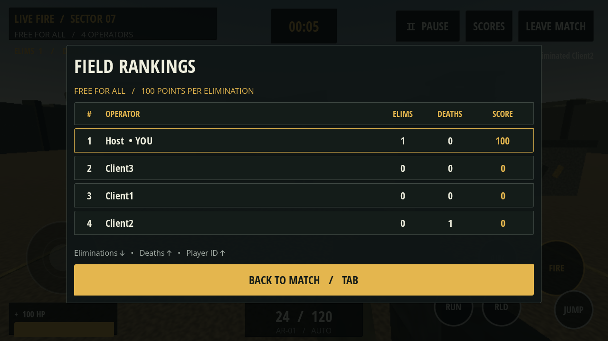
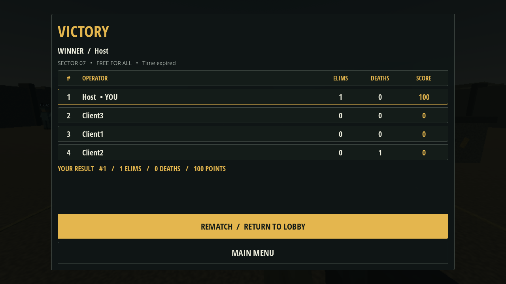

> Architecture retained from earlier phases. Current APK status and limitations: [Phase 5 release report](RELEASE.md).

# Phase 4 — offline LAN Free-for-All

Phase 4 extends the existing Godot 4.6.3 project. It preserves training, movement, touch controls, LAN sessions, prediction, weapons, authoritative health/damage, eliminations and respawns. It adds complete 2–4-player match flow without an internet service. Version is 0.4.0/code 4; every participant must use protocol 4.

## Match architecture

`Rules` (`network/rules.gd`) is the listen-host round authority. The reliable, epoch/revision-guarded flow is **LOBBY → COUNTDOWN → PLAYING → RESULTS → LOBBY**. Clients cannot initiate transitions, change rules or submit scores. Duplicate/illegal transitions and old-round packets are rejected.

The existing session handles joining, ready checks and the scene-load barrier. Host Start requires at least two players and every client ready. The arena loads on every peer; countdown starts only after every required scene reports ready. Movement and combat are blocked on both input and host simulation paths until PLAYING. Countdown shows 3, 2, 1, then GO. Dropping below two players while loading/counting down returns the retained session safely to the lobby.

The default is 300 seconds, unlimited respawns, one arena and no teams. Before hosting, choose 5 minutes, 1 minute or 30 seconds and an optional 0–100 kill limit (0 disables it). The validated host API also supports 5–3600-second durations for tests. The host decrements countdown/time using physics delta. Small ordered corrections are sent five times per second; clients interpolate elapsed time from monotonic local receipt timestamps. Device wall clocks need not agree. Only the host ends a match, at zero time or the kill limit. The round finalizes after the combat tick so one elimination's state is complete before results freeze.

## Scoring and results

The host reads authoritative combat statistics and sends the scoreboard only when statistics or participant status changes. Sorting is eliminations descending, deaths ascending, stable numeric peer ID ascending. Score is derived as eliminations × 100; deaths add no points and subtract none. A repeated kill notification cannot award points because the board reads deduplicated combat state rather than accumulating notifications.

SCORES/Tab opens the live table. It highlights the local operator and shows rank, name, eliminations, deaths and score. It suspends local controls while the host continues. Results contain a single host-generated winner and immutable ranking snapshot, including local statistics. The winner sees VICTORY; others see MATCH COMPLETE. Late input, fire, reload, damage, respawn and duplicate combat events cannot mutate final standings.

Disconnected participants remain in the current round's standings and can win by their recorded ranking; their live row is marked LEFT. Results remain exactly frozen even if someone leaves afterwards. The connected-player count follows the active roster. If one player remains during PLAYING, the timer continues to its normal end. Host departure ends the session and notifies clients; no host migration exists.

Only the host can choose REMATCH / RETURN TO LOBBY. This preserves active peer connections and names, resets clients to Not Ready, destroys old arena/player nodes and clears round state. A new Start increments the epoch and creates fresh health, ammunition, scores, protection/respawn state, timers and input queues. Clients see a waiting state until the host returns them. MAIN MENU leaves the local session; a departing host ends it for all.

## UI

Existing charcoal/gold theme, licensed Open Sans fonts and military visual language continue across host/join/lobby, gameplay, pause, scoreboard and results. The HUD adds a centered host-clock timer, countdown/GO, and SCORES without covering the crosshair; existing health, ammo, elimination counter, player count and feed remain. Tables update on events; timer text updates when its displayed value changes. Overlays use short inexpensive fades, clear disabled states and landscape containers. Pause retains Resume, Settings, Leave Match and Quit Game and never pauses LAN simulation.

Standard menu buttons now accept native touch-to-mouse emulation. Gameplay ignores emulated mouse look, and Android firing uses explicit touch actions, avoiding menu/joystick taps becoming rifle input. The GUI tap regression and existing synthetic multitouch combat both pass. This is synthetic evidence, not physical Android acceptance.

The supplied attachments contain written phases, but no nine-panel reference image. Exact Panel 7/9 visual matching cannot be assessed. The original procedural arena and lightweight weapon/operator assets remain prototypes. Rendered captures use desktop software OpenGL at 1280×720; Android Mobile/Vulkan, cutouts and wider phone screens require device validation.

## Files added or modified

| Files | Change |
| --- | --- |
| `network/rules.gd` | New round state, clock, settings, scoring, results and rematch authority |
| `network/session.gd` | Load barrier integration, epoch/reset flow, lobby reopening, play gates and safe connected-peer sends; protocol 4; unused native client relay disabled |
| `network/match.gd` | Countdown loadout initialization, PLAYING release, results freeze and cleanup |
| `combat/authority.gd`, `player/player.gd` | Round gates on simulation/combat and emulated input filtering |
| `scripts/main.gd` | Scoreboard/results navigation, local menu controls, safe asynchronous round cleanup |
| `ui/score_table.gd`, `ui/scoreboard.gd`, `ui/results.gd` | New event-driven live/final tables and host-only rematch controls |
| `ui/game_hud.gd`, `ui/lan_panel.gd`, `ui/style.gd` | Timer/countdown, scores, lobby rule settings, spacing and disabled contrast |
| `project.godot`, `export_presets.cfg` | Rules autoload, touch menu emulation, version 0.4.0/code 4; Mobile/ARM64/landscape retained |
| `tests/rules_contract.*`, `tests/round_peer.*`, `tools/test_round.py`, `tools/test.sh` | New deterministic contracts, menu tap and real-process round acceptance |
| `README.md`, `docs/` | Build instructions, architecture, evidence, screenshots and limitations |

Existing arena/target, touch HUD, settings, geometry, rifle and remote avatar resources were retained; the source archive contains the complete project. See [executed validation and evidence](VALIDATION.md).

## Android acceptance — not executed

1. Follow [ANDROID.md](ANDROID.md) to install SDK/templates and export/install the same Phase 4 APK on two to four ARM64 Vulkan-capable phones. Use the same local router or hotspot, without upstream internet; follow [LAN.md](LAN.md) for real private IP/routing and isolation troubleshooting.
2. Check landscape menus, names, ready indicators, host marker/count and Start gate. Set the default five minutes, kill limit off. Reject Start with an unready client. Start once all clients are ready; verify all arenas load before 3, 2, 1, GO and no movement/fire during countdown.
3. Move and fire independently; check simultaneous joystick/look/fire, head/body damage, cover, ammo/reload, health, elimination feed, respawn/protection. Open SCORES and compare every row, 100 points per elimination, death count and deterministic ties across phones.
4. Open host and client pause/settings separately; other players and the clock continue. Resume clears held contacts. Verify five-minute expiry, frozen controls/stats, identical winner/rankings and correct local victory/completion messages. The automated suite uses shorter clocks; a full five-minute physical run is still required.
5. Leave a client during results; existing results stay frozen. Clients cannot rematch independently. Host returns everyone to the lobby, names/connections persist, clients ready again, and a new match starts with zero stats, full loadout/health and fresh timers. Repeat with kill limit 1 for early results.
6. Disconnect during countdown, during active play, while dead, and simultaneously. Confirm no ghost actors/respawns or corrupted standings. Leave/force-stop the host; remaining phones must receive a notice and return to a usable menu. Rejoin in a new session.
7. Repeat on hotspot/router configurations and common landscape aspect ratios, including Android Back, keyboards, cutouts, touch cancellation and background/foreground. Measure sustained mid-range 30–60 FPS, audio and thermals; these remain unverified.

## Limitations and Phase 5 readiness

Automated tested paths have no known unresolved failures. Testing covers local independent processes, not delayed/lossy physical Wi-Fi or every device. Phase 5 supplies an APK; see [current release/build evidence](RELEASE.md). Physical Android LAN/touch/audio/performance and Mobile/Vulkan visuals are **NOT VERIFIED**. Host background suspension can interrupt hosting; local pause cannot override Android process scheduling.

There is no host migration, historical hit rewind, public matchmaking, anti-cheat service or persistence of match history. Network cosmetics remain best effort during sustained fire; authoritative combat and match events are reliable. Current hitboxes/art/audio remain lightweight. The listen host is trusted and ENet traffic is not encrypted.

The match foundation is ready for the next development phase at the source/integration level: stable round ownership, deterministic standings, frozen results and reusable rematch sessions are exercised. Android acceptance, performance profiling and realistic latency/loss testing remain gates before production readiness. **This describes the Phase 4 implementation; [Phase 5 release validation](RELEASE.md) is now available.**
