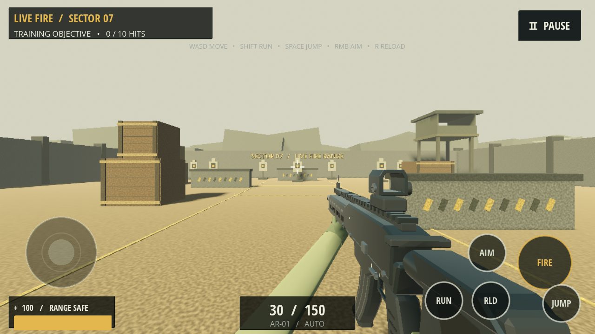
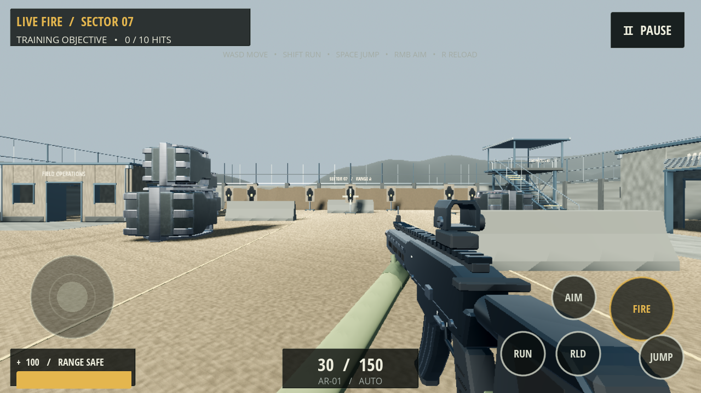
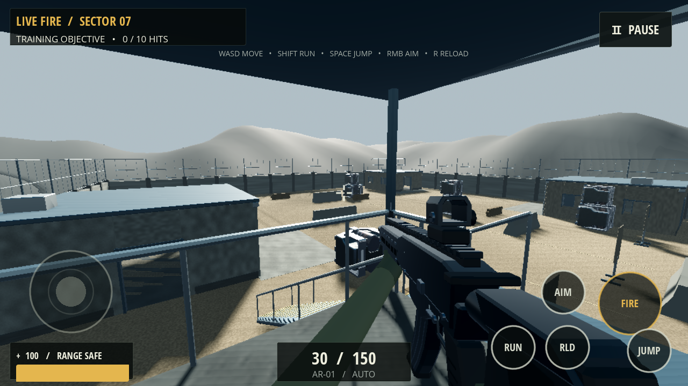

# Sector 07 — visual reconstruction 2/4

Sector 07 is now a compact compound with three usable buildings, a stair-accessible observation tower, layered desert materials, improved target art and stronger foreground/background structure. The Visual Reconstruction 1 rifle, player/controller, UI and combat authority are preserved. Visual Reconstruction 3/4 has not been started.

**[Download the Android arena test build](https://github.com/Muahid1312/ShadowStrike/raw/refs/tags/sector07-v2/releases/sector07-v2/ShadowStrike-sector07-v2-debug.apk). Every LAN player must install this build.** Map protocol 5 rejects earlier arena builds through the existing handshake, preventing mismatched collision. Application identity/version 0.5.0/code 5 and the debug signing certificate are retained. Physical Android rendering, hotspot play and sustained FPS remain **NOT VERIFIED**.

## Environment changes

- **Courtyard:** original cast-profile concrete barriers, nearby sandbag cover, instanced cargo cases, utility drums and clear routes. Existing crate-cover footprints and the four initial spawn coordinates remain; an additional central barrier and sandbag positions add nearby protection.
- **Headquarters:** open front/rear/side doors, real window openings, recessed frames, roof/fascia/drainage, a paved entrance apron and a safety board inside.
- **Workshop:** wide raised-shutter entry, a separate pedestrian route, workbench, roof ventilation and a vehicle apron.
- **Barracks:** a third walk-through structure with multiple exits, roof trim and a flush approach. Respawn positions inside/near buildings were checked with the actual standing capsule.
- **Observation tower:** structural posts, X braces, elevated platform, canopy, railings, a landing and 22 visible stair treads. A matching walkable ramp and guard collisions allow the unchanged controller to reach the deck. The roof has sufficient standing headroom; room roofs remain closed scenery.
- **Range:** original seven target positions and hit extents retained, with imported board/stand meshes, human stencil, center mark, distance markers, backstop berm and range signage. Actual hit lockout, cooldown and feedback continue to work.
- **Depth/materials:** sand/dirt blending, compacted routes/vehicle wear, original concrete/wood/canvas normal maps, shared metallic surfaces, security fencing, a natural escarpment silhouette and subtle distance haze.

Playable ground remains physically flat for predictable movement and client prediction. Its appearance changes through mapped materials, normal detail, wear and flush aprons; berms and escarpments provide height outside the main movement surface. No destructible or synchronized rigid-body system was introduced.

The written brief arrived without the referenced screenshot/reference image attachments. The before images below were captured from the actual previous arena; exact reference-image fidelity cannot be assessed.

## Imported assets and licensing

The **cargo mesh and its albedo/normal/ORM texture set** are adapted from the official [Godot TPS Demo](https://github.com/godotengine/tps-demo), Copyright 2018 **Juan Linietsky and Fernando Miguel Calabró**, under **[CC-BY 3.0](https://creativecommons.org/licenses/by/3.0/legalcode)**. The upstream licence acknowledges original Substance Painter material contributions from GameTextures.com.

Actual source files retrieved: `level/geometry/models/props.glb`, mesh `prop_cargobox3.001`, and `level/textures/props/mid_cargo_box_{albedo,normal,orm}.png`. Changes: mesh extraction, bottom-centered unit normalization, texture resize to 1024×1024 and repacking as `assets/sector07/cargo.glb`. The selected complete files were extracted with CRC validation from a bounded source-archive download. No unrelated source-demo models or gameplay code were imported.

**Buildings, tower, barriers, drums, sandbags, targets, escarpments, terrain shader and original PBR tiles are original project work**, authored through the checked-in Blender/texture builders. No external architecture pack is claimed. Signage uses the existing Open Sans font.

Credits, the upstream licence and the existing font licence are explicitly included in the APK. See [asset source/rebuild guide](../assets/sector07/SOURCE.md), [attribution](../assets/sector07/ATTRIBUTION.txt), [upstream licence](../assets/sector07/TPS_LICENSE.txt) and [source digest/provenance](../assets/sector07/provenance.json). Asset generation is a development step; the installed game needs no external download or internet service.

## Lighting and rendering

One directional sun provides warm afternoon light from an oblique angle, with cooler ambient illumination and a stronger blue sky gradient. ACES exposure is restrained; light and material reflectance were reduced after actual screenshots exposed clipping/washed-out surfaces. Exponential haze is light enough to retain target readability.

The sun uses two shadow splits and a 55 m shadow range; the existing 1024 shadow setting is retained. LOW disables shadows/fog, while MEDIUM/HIGH retain them and keep their existing render scale/MSAA settings. No SSAO, SSR, volumetric fog, dynamic GI, extra shadowed local lights or transparent window sheets were added.

Architecture uses shared StandardMaterial3D PBR materials. The ground shader uses four texture samples for sand/dirt, normal detail and a baked wear mask; it performs no procedural per-pixel noise loop. Material tint factors omitted by the installed Blender exporter are preserved explicitly in the generated standard glTF data. Identical embedded image sources are shared across tinted materials.

## Files created or changed

| Files | Purpose |
| --- | --- |
| `maps/arena.gd` | New compound assembly, deterministic static collisions, instanced cover/props, signage, materials and lighting |
| `maps/target.gd` | Imported target appearance and shared flash material; original signal/hit/cooldown logic and hitbox retained |
| `assets/sector07/compound.glb`, `props.glb`, `cargo.glb` | Actual imported original kit and licensed cargo adaptation |
| `assets/sector07/textures/`, `ground.gdshader`, `target_flash.tres` | Original PBR surfaces, wear mask, terrain shader and static target feedback material |
| `assets/sector07/collision_layout.json`, `geometry_stats.json` | Shared collision definition and authored mesh budgets |
| `tools/build_sector07_assets.py`, `build_sector07_textures.py` | Reproducible development asset builders |
| `network/session.gd` | Compatibility constant only: protocol 4→5 for the changed collision map; RPC/gameplay logic unchanged |
| `export_presets.cfg` | Include CC-BY attribution/upstream licence and existing font licence in the APK |
| `tests/sector07_contract.*`, `sector07_visual.*`, `tools/test.sh` | Map/physics/quality checks and actual first-person captures |
| `tests/lan_edge.gd`, `tools/test_lan_edges.py` | Prove old-map clients are refused even when the lobby has capacity |
| `README.md`, `docs/ANDROID.md` | Updated tower instructions, current map compatibility and visible asset credits |
| `docs/screenshots/sector07-*`, `docs/test-results/sector07-v2/`, `releases/sector07-v2/` | Before/after evidence, tests and separate installable build |

The `arena.tscn` entry, weapon/model files, player movement/touch, menus, settings behavior, combat authority and match rules remain unchanged.

## Actual in-engine comparison

Previous arena, with the reconstructed weapon already present:



New courtyard from the same initial player location:



Usable observation deck, from a standing player camera:



Other actual gameplay frames: [tower approach](screenshots/sector07-tower.png), [headquarters](screenshots/sector07-headquarters.png), [range](screenshots/sector07-range.png), [interior](screenshots/sector07-interior.png). Before views are also retained for the tower, headquarters and range. These are Godot gameplay frames, not concept art or Blender previews.

Visual review corrected overbright material factors, target scene-owner warnings, mirrored text seen from the back of signs, canopy headroom and overly faceted distant silhouettes. Remaining weaknesses include simple original architecture/prop forms, repeated fence modules, limited small dressing and procedural rather than scanned surface wear. The result is a mobile-budget environment, not photogrammetric production art.

## Tests performed

| Workflow | Actual result |
| --- | --- |
| Existing training/network/rules/release/weapon contracts | 44 + 34 + 13 + 27 + 25 checks passed |
| New map contracts | **31 checks passed** |
| Total integration/contracts | **174 checks, 0 failures** |
| Four real ENet processes: combat | **114 checks, 0 failures** |
| Four real ENet processes: full rounds/results/rematch | **113 checks, 0 failures** |
| Two-process movement regression | **38 checks, 0 failures** |
| Capacity, old-map refusal, active-match refusal, graceful exit and forced host loss | Passed |
| Android debug export | Passed |
| APK ZIP, signature, alignment, packaged collision/credits | Passed |
| Exported session bytecode | Actual APK reports protocol **5** |
| Physical Android installation/rendering/FPS/hotspot | **NOT VERIFIED** |

Map tests query all four initial and seven respawn positions with the real standing capsule, test four building entrances, shoot through a real window opening and into the wall beneath it, test barrier obstruction/clearance, check the security boundary, walk the actual controller up the stairs and stand on the landing, validate deck clearance, exercise target feedback/reset and check all quality presets.

The map uses 120 explicit static collision bodies plus seven target hitboxes, with no new dynamic physics. Door/window openings and convex barriers/ramps use the same committed collision data on every peer. The existing protected starts and nearby cover let players move into protection; spawn coordinates and the existing two-second spawn protection are preserved. Competitive balance, tower sightline advantage and repeated live human play still need acceptance testing.

Multiplayer tests use independent Godot OS processes and actual ENet UDP, not mocked transport. Existing shooting, body/head damage, cover, ammo/reload, respawn/protection, scoring, readiness/load barriers, timers, results, rematch and touch/controller contracts remain intact. The new legacy-map probe explicitly sends protocol 4 to a protocol-5 host with free slots, is rejected and leaves the valid session usable.

Raw evidence: [contracts](test-results/sector07-v2/contracts.txt), [map checks](test-results/sector07-v2/map-checks.txt), [combat](test-results/sector07-v2/combat-4.txt), [rounds](test-results/sector07-v2/round-4.txt), [movement](test-results/sector07-v2/lan-2.txt), [edges](test-results/sector07-v2/edges.txt), [Android build](test-results/sector07-v2/android-build.txt), [packaged protocol](test-results/sector07-v2/apk-protocol.txt).

## Performance and Android status

The authored compound has **28,640 triangles** before instanced props/targets/weapon. Including the placed cargo, bags, drums, targets and existing rifle gives roughly **66,000 triangles** before text/remote operators. Detail is batched by spatial chunk/material. Cargo, barrels and bags use MultiMesh; geometry/collision are static. Fourteen source textures are at most 1024×1024; original tiles are 512×512. Texture atlases and shared image sources limit material/texture proliferation.

In the final desktop **OpenGL Compatibility/Low/Mesa llvmpipe** sample, scene draw calls were **145 versus 225** for the previous weapon build. Godot's static allocation monitor reported **52,624,246 bytes versus 48,178,570** previously; these figures exclude much GPU/driver memory and are not Android RSS. The 60-frame sample took **2,235 ms** on software rendering. The richer geometry/texturing adds work despite fewer draw calls; no FPS improvement or phone performance guarantee is claimed. [Raw profile](test-results/sector07-v2/profile.json).

The Android project remains Mobile/Vulkan, ARM64, minimum API 24/target 36. Its package builds and the APK v2 signature/16 KB ZIP alignment verify; native libraries are unchanged. Actual Android drivers, memory/thermals, sustained FPS and physical touch/hotspot play remain unverified. This host lacks usable Vulkan surface support, so screenshots are software OpenGL. The capture process prints pre-existing OpenGL texture cleanup diagnostics at shutdown, also recorded in the old-map capture; gameplay/contract and ENet logs are clean. Optional Blender Draco warnings do not affect the deliberately uncompressed GLBs. Those logs are retained without treating them as phone acceptance.

The final APK is **92,657,251 bytes** and retains the previous debug certificate. Its collision JSON and credit files were checked against source; there is no nested APK payload. SHA-256:

```text
d8eee10717bf7f30632924223d1f9200db685fa447e2ea6f1c5dea5ac40ee58d
```

Install `ShadowStrike-sector07-v2-debug.apk` over the earlier test build using `adb install -r` or open the transferred APK and approve the update. Install the **same new build on every phone** before hosting/joining. Test building routes, target fire, tower ascent/descent, spawn/respawn, actual moving-player fights, round completion/rematch and sustained LOW/MEDIUM/HIGH FPS. Use the existing [Android/hotspot guide](ANDROID.md), with this build's **protocol 5** requirement. Universal hotspot compatibility and production readiness are not claimed. No Visual Reconstruction 3/4 work was begun.
