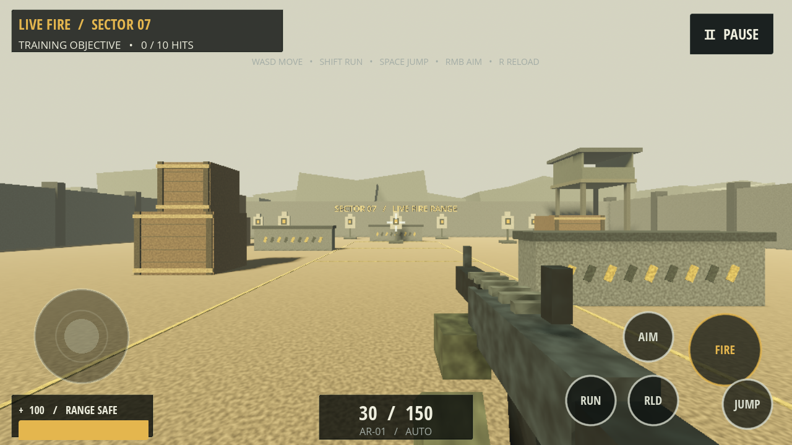
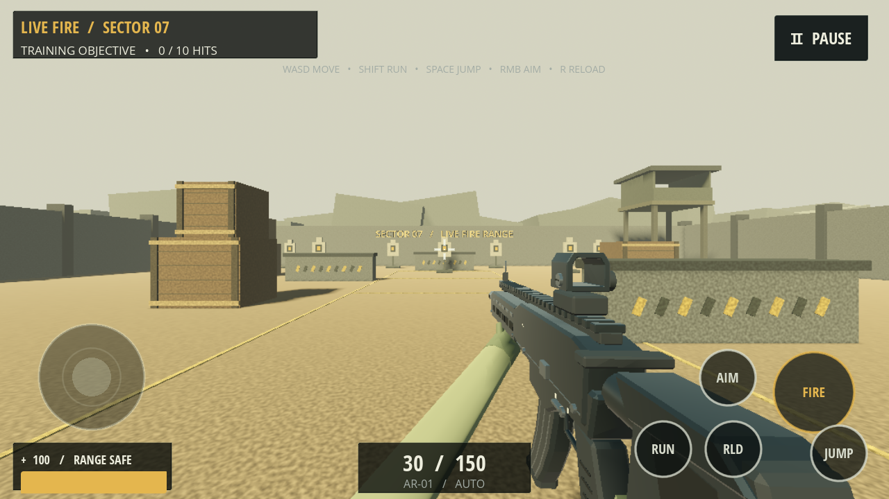
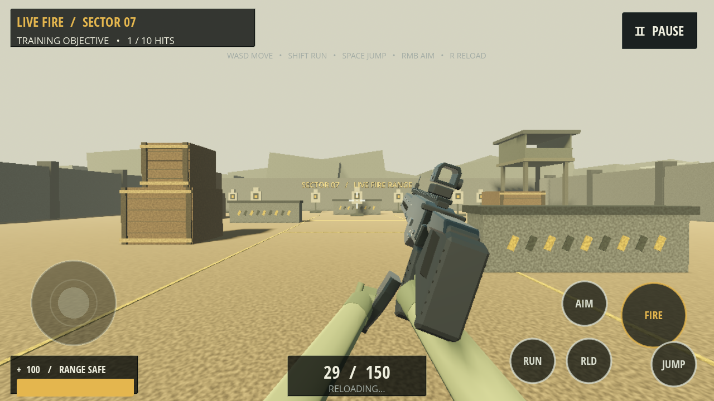

# Visual reconstruction 1/4 — AR-01 first-person rifle

The startup-built block rifle has been replaced by an original modeled GLB. Work is limited to first-person weapon art/presentation, its tests and review artifacts. Map, menus, touch/controller code, networking, combat authority and match rules are unchanged. Prompt 2 has not been started.

[Download the Android weapon test build](https://github.com/Muahid1312/ShadowStrike/raw/refs/tags/weapon-v1/releases/weapon-v1/ShadowStrike-weapon-v1-debug.apk). This retains application version 0.5.0/code 5 and protocol 4, with the same debug certificate; install it over the earlier testing build. The earlier v0.5.0 artifact is retained separately. Physical Android rendering/input/performance remain **NOT VERIFIED**.

## Source and licence

The GitHub asset search did not yield a suitable third-party model with a verifiable redistribution licence. The permitted original-model fallback was used: `tools/build_rifle_asset.py` constructs the asset in installed **Blender 4.3.2** and exports the actual `assets/weapons/ar01/AR01.glb`, which Godot imports. No external weapon model or texture was downloaded or claimed as imported.

Geometry, materials and 64×64 muzzle sprite are original project assets, with no new third-party weapon/texture attribution dependency. The AR-01 mesh marking uses the existing Open Sans font; its existing OFL licence is retained at `assets/fonts/LICENSE.txt`. Existing project shooting/reload WAVs are reused unchanged. See [asset provenance and rebuild instructions](../assets/weapons/ar01/SOURCE.md). The model does not impose a new separate licence on the project.

## Visual reconstruction

- Compact forged/chamfered receiver, receiver seam, bolt catch, selector/index marks, take-down pins, dust cover and engraved AR-01 marking.
- Octagonal free-float handguard, M-LOK-style recessed slots, ventilation detail, Picatinny rail, exposed barrel shoulder and open-bore muzzle brake.
- Curved, ribbed magazine and floor plate; slanted pistol grip, open trigger guard and separate trigger.
- Buffer tube, sculpted skeleton-stock profile, cheek riser and rubber-style butt pad.
- Compact beveled, hollow reflex-style optic housing and front post. The existing HUD crosshair remains the aim reference; there is no opaque fake lens or extra magnification logic.
- Dark graphite/steel/polymer PBR materials with different metallic/roughness values and modeled edge/detail contrast. These are textureless low-poly surfaces, not a photorealistic scanned material set.
- Original stylized gloved hands and tapered sleeves. Both sleeves enter from below the camera frame and follow the hand positions, avoiding exposed floating elbow caps during reload.

The gun occupies the lower right at hip, moves to the centered optic when aiming, and leaves the center target area clear in normal play. Camera-near-plane tests check actual model vertices during hip, aim, sprint and reload. Wider landscape placement was captured at 1600×720 as well as 1280×720.

## Animation and gameplay separation

`weapons/rifle_presentation.gd` is a camera-child art layer. It interpolates breathing, walking bob, lowered/canted sprint pose, recoil translation/rotation, magazine extraction/insertion and support-hand reach. It uses named imported components and two lightweight arm transforms; there is no skeleton, IK solver, per-frame mesh generation or animation-driven gameplay position.

The existing rifle script still owns training ammo/cooldown/reload, camera-origin raycasts, recoil callbacks and audio. LAN ammo/damage remain owned by the unchanged CombatAuthority. The viewmodel never writes camera aim, health, ammunition, hitboxes or network state. Existing camera recoil values are preserved. Visual muzzle position is never used as a raycast origin.

Training reload is still1.7 seconds; LAN remains host-authoritative2 seconds. LAN presentation reads the host's remaining reload time. Magazine/hand transforms seat on host completion and reset on death/cancellation; no extra ammo transfer occurs in the visual layer. Shooting remains disallowed during reload by the existing gameplay path.

Accepted local or host-confirmed fire immediately shows a short, textured muzzle billboard at the model's Muzzle locator, then the existing flash timer removes it. It uses2 triangles and no particles or dynamic lights. Existing reliable opening-shot/best-effort sustained cosmetics and remote-avatar shot/reload effects are preserved; the third-person avatar's simplified weapon model is unchanged.

## Files changed

| Files | Purpose |
| --- | --- |
| `weapons/rifle.gd` | Replace old Geometry.box startup meshes with presentation layer; preserve weapon logic/audio; immediate flash visibility |
| `weapons/rifle_presentation.gd` | New pose, recoil, sprint, hand/arm and host-timed magazine animation |
| `assets/weapons/ar01/AR01.glb`, imports, `geometry_stats.json` | Actual original imported model and geometry audit |
| `assets/weapons/ar01/muzzle_flash.png`, `SOURCE.md` | Small original flash sprite and provenance |
| `tools/build_rifle_asset.py` | Reproducible original modeling/export source |
| `tests/weapon_contract.gd/.tscn`, `tests/weapon_visual.gd/.tscn`, associated UIDs | Presentation isolation, budget/clipping/reload tests and actual-game screenshots |
| `tools/test.sh` | Run the new weapon contracts after existing suites |
| `docs/screenshots/weapon-*`, `docs/test-results/weapon-v1/`, this report | Before/after, pose captures and evidence |
| `releases/weapon-v1/` | Separate downloadable APK and SHA-256 |

`weapons/rifle.tscn` remains the same entry scene. No changes were made to `maps/`, `ui/`, `network/`, `combat/`, `player/`, `scripts/`, project settings or Android export settings.

## Tests and evidence

| Check | Actual outcome |
| --- | --- |
| Godot 4.6.3 import/parsing | Passed |
| Existing training integration | 44 checks, 0 failures |
| Existing network/export/UI contracts | 34 checks, 0 failures |
| Existing match/menu-touch contracts | 13 checks, 0 failures |
| Existing release/graphics/native-touch/lifecycle/audio checks | 27 checks, 0 failures |
| New weapon presentation contracts | 25 checks, 0 failures |
| Total integration/contracts |**143 checks passed** |
| Real host/client combat | 64 checks, 0 failures |
| Real four-process combat |**114 checks, 0 failures** |
| Actual rendered game captures |Idle, ADS, walking, sprint, fire, magazine-out reload, seated reload, wide view |
| Android Gradle APK export |Passed |
| APK integrity, signature and alignment |Passed; original native libraries byte-identical; previous signing certificate matches |
| Physical Android rendering/performance |**NOT VERIFIED** |

Weapon-specific checks cover GLB components, triangle/surface budget, muzzle attachment, hip/ADS/sprint/reload clipping, optic alignment, visual recoil, idle sway, camera/health/ammo isolation, real firing, magazine/hand motion, on-screen extracted magazine, reload fire exclusion, original ammo transfer/timing, network timer ownership, host completion and cancellation on death. Existing four-process acceptance additionally verifies real host physics raycasts, head/body/cover damage, ammunition, automatic firing, reloads, kills/deaths, respawn/protection, touch wiring, state agreement and replicated firing effects.

Raw evidence: [contracts](test-results/weapon-v1/contracts.txt), [two-peer combat](test-results/weapon-v1/combat-2.txt), [four-peer combat](test-results/weapon-v1/combat-4.txt), [model build](test-results/weapon-v1/model-build.txt), [Android build](test-results/weapon-v1/android-build.txt), [signature](test-results/weapon-v1/apk-signature.txt), [alignment](test-results/weapon-v1/apk-alignment.txt).

## Actual gameplay screenshots

Before:



After:



Magazine-out reload:



Additional actual game frames: [ADS](screenshots/weapon-aim.png), [walking](screenshots/weapon-walk.png), [sprint](screenshots/weapon-sprint.png), [firing](screenshots/weapon-fire.png), [magazine seated](screenshots/weapon-reload-seated.png), [wide landscape](screenshots/weapon-wide.png). These are in-engine gameplay frames, not concept art or Blender renders.

## Android budget and limitations

The complete first-person model, including hands/sleeves, has **6,982 triangles**, 6 mesh components and 15 material surfaces sharing7 PBR materials. The source GLB is457,596 bytes; the only new texture is a 1,325-byte 64×64 flash sprite. This is substantially more detailed geometry than the old boxes, with a bounded mobile-oriented budget. Disconnected detail is batched by moving component/material rather than creating a node for every screw or rail tooth at runtime.

The same desktop software OpenGL/Low profile measured **225 scene draw calls/frame versus the earlier 226**,0 idle HUD draws/60frames and 48,178,570 bytes in Godot's static allocation monitor versus the earlier 48,153,922. The flash is2 triangles versus80. The 60-frame elapsed sample was 1,337 ms during other build work; **no FPS improvement or Android frame-rate claim follows from this sample**. Static allocation monitoring excludes much driver/GPU memory and is not Android RSS. [Raw profile](test-results/weapon-v1/profile.json).

The final APK is 79,852,810 bytes, about162KiB larger than the previous build. Its imported AR01 scene and presentation bytecode were verified in the package; there is no nested APK payload. SHA-256:

```text
7d9cf4fdffeac0661666aa92f09b0ae09ca8bb49ac7c1230dd2863fbb3bfdecf
```

The Android preset remains Mobile/Vulkan. This machine lacks the required Vulkan surface support; an attempted Mobile run fell back to OpenGL. Screenshots therefore use OpenGL Compatibility/Mesa llvmpipe, not Android or a successfully initialized Vulkan renderer. The desktop capture process printed OpenGL texture cleanup diagnostics at shutdown, also observed in the original-rifle capture before replacement; gameplay/contract and ENet test logs are clean. [Capture log](test-results/weapon-v1/screenshots.txt), [Vulkan attempt](test-results/weapon-v1/vulkan-attempt.txt). Blender also reports an unavailable optional Draco encoder; the valid GLB is deliberately uncompressed and requires no Draco runtime.

The visual style remains an original low-poly rifle and stylized hands, not a photorealistic production scan or motion-captured reload. Third-person avatar art is outside this first-person task. Phone FPS/thermals, touch ergonomics while viewing the model and Mobile/Vulkan materials need physical acceptance. Desktop functional/visual work is complete; the Android performance acceptance criterion remains unverified.

Install `ShadowStrike-weapon-v1-debug.apk` with `adb install -r` or open the transferred APK and approve the update. On a phone, check hip/ADS framing, simultaneous movement/look/fire, sustained automatic fire, reload/magazine seating/cancellation, sprint and common 16:9/18:9/20:9 layouts. Repeat a two-phone LAN fight and respawn; compare host/client ammo and damage. Measure sustained LOW/MEDIUM/HIGH FPS against the old build before declaring the Android performance criterion passed. No Prompt 2 work was begun.
